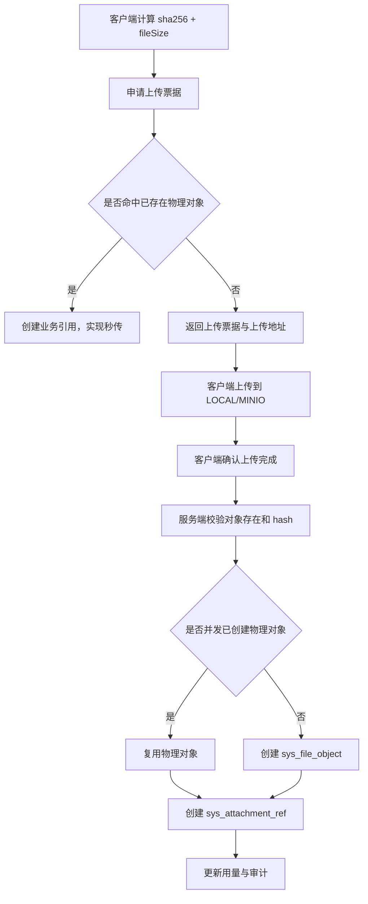
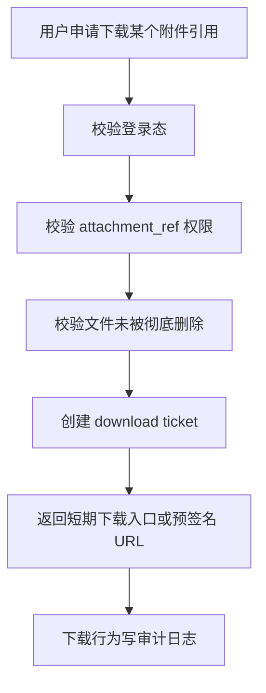

# module-file 第一版开发范围

## 一、文档目的

本文档用于把文件中心从架构设计推进到可开发范围。

当前目标不是一次性做完整企业网盘，而是先落地一套稳定的文件底座，支撑后续：

- 私聊附件
- 群文件
- 个人文件
- 审批附件
- 知识库原文件
- Agent 临时产物与文件读取授权

第一版重点解决：

- 文件如何上传
- 同一文件如何去重
- 文件名和物理对象如何分离
- 个人、群、知识空间如何计量
- 超出配额或容量不足时如何拦截
- 文件如何下载
- 删除后如何进入回收站
- 无引用物理文件如何延迟清理

---

## 二、第一版边界结论

### 1. 第一版必须做

| 能力 | 说明 | 交付口径 |
| --- | --- | --- |
| 存储 Provider | 支持 `LOCAL`、`MINIO` | `LOCAL` 用于本机开发，`MINIO` 用于私有化部署默认方案 |
| 两段式上传 | 申请上传票据、上传对象、确认上传 | 不允许业务接口直接接收文件二进制 |
| 物理去重 | 按 `content_sha256 + file_size` 去重 | 文件名不参与去重 |
| 业务引用 | 同一物理文件可被多个业务场景引用 | 每次发送或保存生成新的附件引用 |
| 配额校验 | 个人/空间/组织总池/真实容量四重校验 | 上传前拦截，不等确认后才报错 |
| 下载票据 | 下载前生成短期票据或预签名 URL | 不暴露长期对象地址 |
| 回收站 | 删除业务引用，保留可恢复窗口 | 默认 30 天 |
| 延迟清理 | 无引用物理对象延迟清理 | 默认 7 天 |
| 访问审计 | 上传、下载、删除、恢复、清理写审计 | 第一版可先写统一审计日志 |

### 2. 第一版明确不做

| 暂不支持项 | 原因 | 后续落点 |
| --- | --- | --- |
| 文件在线预览与转码 | 会引入异步转码、缓存和格式兼容复杂度 | `module-doc` 或文件中心第二版 |
| 防病毒真实扫描 | 第一版先预留 `scan_status`，不接杀毒网关 | 安全治理阶段接 ClamAV 或企业网关 |
| 水印与敏感下载原因 | 需要配合文档密级、审计策略 | 知识库与审计治理阶段 |
| WebDAV | 适合作为扩展存储，不适合第一版主链路 | 外部存储扩展阶段 |
| OSS/COS/S3 | 第一版私有化优先，避免 Provider 过早膨胀 | 云部署适配阶段 |
| Agent 流程执行 | 本阶段只保留文件授权边界，不实现 Agent 执行链 | `module-agent` |
| 公网匿名永久分享 | 风险高，和企业私有化定位不一致 | 外链分享专题单独设计 |

---

## 三、模块职责

`module-file` 是平台共享底座，不直接关心“这是聊天文件还是审批文件”，它只提供文件能力。

### 1. module-file 负责

- 上传票据创建与过期治理
- 文件对象定位与校验
- 物理对象去重
- 附件业务引用创建、删除、恢复
- 云空间配额校验与用量统计
- 下载票据创建与过期治理
- 无引用物理对象延迟清理
- 文件访问审计事件落点

### 2. module-file 不负责

- 判断某个群消息是否能发送
- 判断某个审批单是否允许追加附件
- 判断知识库文档是否可以入库
- 判断 Agent 是否能读取某个业务上下文
- 解析文件内容、切片、向量化

这些判断由调用方业务模块负责，`module-file` 只校验附件引用层面的通用权限和配额。

---

## 四、核心对象口径

### 1. 物理对象

`sys_file_object` 表示真实二进制对象。

关键规则：

- 同一份二进制内容只保留一条物理对象记录
- 主去重键为 `content_sha256 + file_size`
- `content_md5` 可作为兼容与快速校验字段，不作为主唯一依据
- `storage_provider + bucket_name + object_key` 描述文件真实位置
- `ref_count` 表示仍有多少有效业务引用

### 2. 业务引用

`sys_attachment_ref` 表示某个业务对象引用了一个文件。

关键规则：

- 文件名只放在业务引用层
- 私聊、群聊、个人文件、知识库可以用不同文件名引用同一物理对象
- 删除优先删除业务引用，不直接删除物理对象
- 回收站恢复恢复的是业务引用，不重新上传文件

### 3. 上传票据

`sys_upload_ticket` 表示一次上传意图。

关键规则：

- 票据有过期时间
- 票据只能被创建人确认
- 确认接口必须幂等
- 已确认票据重复确认应返回同一个附件引用或明确已确认状态
- 过期未确认票据进入临时对象清理流程

### 4. 下载票据

`sys_download_ticket` 表示一次短期下载授权。

关键规则：

- 下载票据必须绑定 `attachment_ref_id`
- 下载前必须校验业务引用权限
- 单文件下载默认 5 到 10 分钟有效
- 票据过期只影响链接，不影响原文件

---

## 五、第一版核心流程

### 1. 上传流程

### 2. 上传前置校验

上传票据创建前必须校验：

| 校验项 | 拦截提示口径 |
| --- | --- |
| 文件大小超过场景限制 | 当前场景最大允许上传大小为 `X` |
| 文件类型不允许 | 当前场景不支持该文件类型 |
| 个人空间不足 | 个人云空间不足，请清理文件或联系管理员扩容 |
| 群/知识空间不足 | 当前空间容量不足，请联系空间管理员 |
| 企业长期文件池已满 | 企业文件总空间不足，请联系系统管理员扩容 |
| 存储后端真实容量不足 | 存储服务空间不足，系统已进入写入保护 |

### 3. 确认上传流程

确认接口必须做以下校验：

- 票据存在且未过期
- 当前用户是票据创建人或后台授权操作者
- 对象已写入 `LOCAL` 或 `MINIO`
- 服务端重新计算 `content_sha256 + file_size`
- 确认请求体中的业务归属 `owner_type + owner_id` 仍有效
- 当前业务引用创建权限仍然有效
- 并发情况下只生成一条最终物理对象

### 4. 下载流程

### 5. 删除与恢复流程

删除业务引用：

1. 校验操作者是否有删除权限。
2. 标记 `sys_attachment_ref.deleted_at/deleted_by/purge_after`。
3. 减少对应逻辑空间可见文件数。
4. 保留用量占用，直到彻底删除后再释放。
5. 写审计日志。

恢复业务引用：

1. 校验引用仍在回收站保留期内。
2. 校验操作者是否有恢复权限。
3. 重新做配额复核。
4. 清空 `deleted_at/deleted_by/purge_after`。
5. 写审计日志。

彻底删除引用：

1. 校验回收站到期或操作者具备彻底删除权限。
2. 彻底关闭业务引用。
3. 更新 `ref_count`。
4. 如果物理对象无引用，标记进入延迟清理队列。
5. 写审计日志。

---

## 六、接口包范围

第一版接口分为员工端和后台端两类。

### 1. 员工端

| 接口 | 第一版用途 |
| --- | --- |
| `POST /api/employee/files/upload-tickets` | 申请员工端上传票据 |
| `POST /api/employee/files/confirm-upload` | 员工端确认上传完成 |
| `GET /api/employee/files/quota` | 查询我的云空间与企业总池摘要 |
| `POST /api/employee/files/{attachmentRefId}/download-tickets` | 申请下载票据 |
| `POST /api/employee/files/{attachmentRefId}/trash` | 移入回收站 |
| `POST /api/employee/files/{attachmentRefId}/restore` | 从回收站恢复 |
| `DELETE /api/employee/files/{attachmentRefId}` | 彻底删除业务引用 |

### 2. 后台端

| 接口 | 第一版用途 |
| --- | --- |
| `POST /api/admin/files/upload-tickets` | 申请后台上传票据 |
| `POST /api/admin/files/confirm-upload` | 后台确认上传完成 |
| `GET /api/admin/files/storage-summary` | 查询企业存储摘要 |
| `GET /api/admin/files/quota-policies` | 查询配额策略 |
| `POST /api/admin/files/quota-policies` | 创建配额策略 |
| `PUT /api/admin/files/quota-policies/{id}` | 更新配额策略 |
| `GET /api/admin/files/recycle-bin` | 回收站治理列表 |
| `POST /api/admin/files/recycle-bin/{attachmentRefId}/restore` | 管理员恢复文件 |
| `DELETE /api/admin/files/recycle-bin/{attachmentRefId}` | 管理员彻底删除文件 |
| `POST /api/admin/files/cleanup-jobs/run` | 手动触发清理任务 |

详细请求体、响应体和测试点见：

- `docs/接口与测试/文件模块/接口文档_文件中心接口.md`
- `docs/接口与测试/文件模块/接口测试用例_文件中心接口.md`

---

## 七、数据落地顺序

第一版实现时建议不要直接改已经存在的 `V1__init_schema.sql`，除非项目明确重新初始化早期库。

推荐顺序：

1. 新增 `V2__enhance_file_center_schema.sql`
2. 增强或补齐 `sys_file_object`
3. 增强或补齐 `sys_attachment_ref`
4. 增强或补齐 `sys_upload_ticket`
5. 新增 `sys_storage_quota_policy`
6. 新增 `sys_storage_usage`
7. 新增 `sys_download_ticket`
8. 按需要复用 `sys_audit_log`

原因：

- 保持迁移脚本可追溯
- 避免本地库和后续部署库出现结构漂移
- 方便单独回归文件中心 DDL

---

## 八、测试通过标准

第一版至少满足以下标准，才进入消息、文档、知识库或 Agent 文件联动：

| 类型 | 通过标准 |
| --- | --- |
| 编译 | `server` 编译通过 |
| DDL | MySQL 迁移能从空库执行成功 |
| 上传 | 未命中去重时可完成上传票据到确认闭环 |
| 秒传 | 已存在物理对象时不重复创建物理对象 |
| 并发 | 同一文件并发确认只产生一条物理对象 |
| 配额 | 个人、空间、组织总池、真实容量不足都能明确拦截 |
| 下载 | 无权限、已删除、票据过期都不能下载 |
| 回收站 | 删除、恢复、彻底删除语义稳定 |
| 清理 | 过期票据、过期下载票据、无引用物理对象可被清理任务处理 |
| 审计 | 上传、下载、删除、恢复、彻底删除有审计记录 |

---

## 九、后续衔接

完成 `module-file` 第一版后，后续模块的衔接方式如下：

| 后续模块 | 衔接方式 |
| --- | --- |
| `module-im` | 消息发送只保存附件引用 ID，不直接处理文件对象 |
| `module-doc` | 文档版本指向文件对象或附件引用 |
| `module-kb` | 知识文档入库前校验文件扫描状态与知识空间权限 |
| `module-workflow` | 审批附件通过业务引用绑定申请单 |
| `module-agent` | Agent 通过业务上下文申请文件读取授权，不直接按物理对象读取 |

---

## 十、当前阶段结论

`module-file` 第一版应该作为平台共享底座先落地。

它的成功标准不是“像网盘一样功能丰富”，而是：

- 上传可靠
- 去重可靠
- 配额可解释
- 删除可恢复
- 下载可审计
- 后续模块不用重复造文件能力
